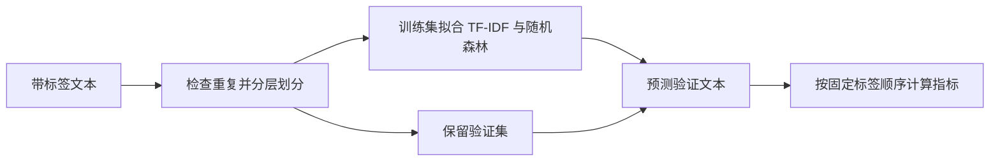

# 招聘文本分类：工程实现与设计取舍

隔离训练信息，明确批处理失败

**问题。** 在划分数据前拟合 TF-IDF 会把验证文本带入词表；分类器的内部类别顺序也可能与输出约定不同。批量调用外部服务时，超时、非法响应和认证失败需要终止语义，并发完成顺序不能改变记录与预测的对应关系。

**机制。**

- **先 split，后 fit：** [`data.py`](../src/job_text_classification/data.py) 检查标签，拒绝去空白、大小写规范化后相同的文本，再用固定种子按类别划分。 [`cli.py`](../src/job_text_classification/cli.py) 只把训练子集交给 `fit`；验证文本仅经过已拟合流水线的 `predict`。字符二至四元组 TF-IDF 与随机森林封装在 scikit-learn `Pipeline` 中。
- **按 `classes_` 对齐概率：** [`baseline.py`](../src/job_text_classification/baseline.py) 将 `predict_proba` 的每列先映射到分类器的真实类别，再按固定公共标签顺序输出。未参与训练的类别填入 `0.0`；指标计算还检查输入记录与预测的 ID 顺序一致。
- **有界 HTTP 调用：** [`http_adapter.py`](../src/job_text_classification/http_adapter.py) 为请求配置 timeout 和最大 attempts，失败后有限退避；除 429 外的 4xx 直接结束。响应大小和标签范围受检查。`ThreadPoolExecutor.map` 保留输入顺序，每条失败记录也会返回状态；CLI 写出结果后在有失败时返回退出码 2。输出保留记录 ID、标签、状态和概率，不写入输入原文、服务回复正文或凭据。

**小例子。** 分类器内部顺序为 `[人工智能, 环保]`，返回概率 `[0.2, 0.8]` 时，公开结果仍按 `[环保, 人工智能, 否]` 输出 `{环保: 0.8, 人工智能: 0.2, 否: 0.0}`。并发处理中第一条较慢、第二条先完成，最终结果仍以第一条、第二条排列；认证失败不会用完全部重试次数。

**设计取舍。** 拒绝规范化重复文本是明确的划分约束，没有解决语义近重复、同公司岗位泄漏或时间漂移；正式研究还需要独立测试方案。固定标签映射使接口稳定，不代表三类预测已经校准。保序意味着慢请求会影响后续结果交付；当前实现收集全部结果，不提供流式完成通知。timeout 约束请求等待，不是整个任务的严格总时限。该 HTTP 适配器遵循 `message / mode / textResponse` 协议，不包含知识库、索引或检索链路。

**测试入口：** [`test_regressions.py`](../tests/test_regressions.py) 覆盖训练词表隔离、固定种子与重复文本、概率列映射、记录对齐、模型保存加载、超时与非法响应、401 快速失败、并发保序及输出不含原文。运行方法见[项目 README](../README.md)。
